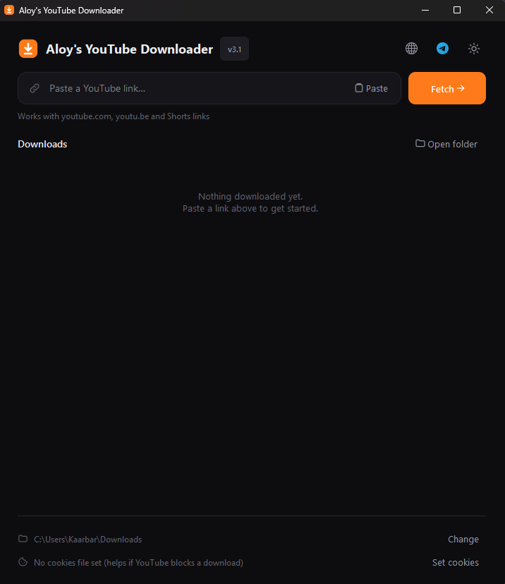

# Aloy's YouTube Downloader ⬇️

**Paste a YouTube link, pick a format and quality, download.**

**[Open the YouTube Downloader page](https://actually-aloy.github.io/site/ytdownloader)** — a small live demo you can click, FAQ and the download button.

Aloy's YouTube Downloader is a simple desktop app for saving YouTube videos as video or audio. It shows you the thumbnail, title, channel and length first, then downloads in the format and quality you choose.

> **Note:** This is a closed-source project. All rights are reserved.

---

## 🚀 Features

- **Video and audio:** MP4, MKV and WebM for video; MP3, M4A (AAC), Opus, FLAC and WAV for audio.
- **Pick the quality:** Best available or any quality the video has (up to 4K). Audio at 128, 192, 256 or 320 kbps, with FLAC and WAV lossless.
- **Preview first:** Thumbnail, title, channel and duration before anything downloads.
- **Downloads list:** Progress, speed and time left for each download, cancel any of them, and show finished files in their folder. Finished downloads are remembered between launches.
- **Stubborn videos:** If YouTube rejects a request, the app retries in other ways and explains errors in plain words.
- **Cookies support:** Add a `cookies.txt` from your logged-in browser to get past bot checks and age-restricted videos.
- **Dark and light themes**, remembered between launches.
- **Update notice:** Checks GitHub on startup and offers a **View release** button when there is a newer version.

---

## 💻 Installation (Portable)

Fully portable. No installation is needed.

1. Download the latest `.zip` from the **[Releases page](https://github.com/actually-aloy/aloys-youtube-downloader/releases)**.
2. Extract the zip to any folder on your PC.
3. Run `Aloys YouTube Downloader.exe` to launch the app.

Want a look first? Try the demo and read the FAQ on the [YouTube Downloader page](https://actually-aloy.github.io/site/ytdownloader).

---

## 📸 Screenshot

  

---

## 🍪 If YouTube blocks a download

If you see **"Sign in to confirm you're not a bot"**, it usually clears up after a few tries. If it keeps happening:

1. Install a "Get cookies.txt LOCALLY" extension in Chrome, Firefox or Edge.
2. Log into youtube.com in that browser.
3. Open any YouTube page, click the extension icon and export `cookies.txt`.
4. In the app, press **Set cookies**, then **Select file**, and choose the file you exported.

Age-restricted videos need the same thing.

---

## 💾 Settings

Your download folder, theme, cookies choice and finished downloads are saved in `aytd_settings.json` next to the app. When you update, keep that file and your settings carry over.

---

## 📞 Contact

Got questions or feedback? Hit me up on Telegram: [@actually_aloy](https://t.me/actually_aloy)

---

 

# 📖 فارسی (Persian)

## 🚀 درباره برنامه

👉 **[صفحه‌ی YouTube Downloader را باز کنید](https://actually-aloy.github.io/site/ytdownloader)** — دموی زنده، سؤال‌های رایج و دکمه‌ی دانلود در یک نگاه.

**Aloy's YouTube Downloader** یک برنامه‌ی دسکتاپ ساده برای ذخیره‌ی ویدیوهای یوتیوب به‌صورت ویدیو یا صدا است. اول عکس بندانگشتی، عنوان، کانال و مدت‌زمان را نشان می‌دهد و بعد با فرمت و کیفیتی که انتخاب کرده‌اید دانلود می‌کند.

> **نکته:** این پروژه متن‌باز نیست و کلیه حقوق آن محفوظ است.

---

## ✨ امکانات

- **ویدیو و صدا:** MP4، MKV و WebM برای ویدیو؛ MP3، M4A (AAC)، Opus، FLAC و WAV برای صدا.
- **انتخاب کیفیت:** بهترین کیفیت موجود یا هر کیفیتی که ویدیو دارد (تا 4K). صدا با ۱۲۸، ۱۹۲، ۲۵۶ یا ۳۲۰ کیلوبیت‌برثانیه و FLAC و WAV بدون افت.
- **پیش‌نمایش:** عکس بندانگشتی، عنوان، کانال و مدت‌زمان قبل از دانلود.
- **لیست دانلود:** پیشرفت، سرعت و زمان باقی‌مانده‌ی هر دانلود، امکان لغو، و نمایش فایل‌های تمام‌شده در پوشه‌شان. دانلودهای تمام‌شده بین اجراها یادآوری می‌شوند.
- **ویدیوهای لجباز:** اگر یوتیوب درخواستی را رد کند، برنامه راه‌های دیگر را امتحان می‌کند و خطاها را به زبان ساده توضیح می‌دهد.
- **پشتیبانی از کوکی:** یک `cookies.txt` از مرورگر واردشده‌تان اضافه کنید تا بررسی ربات و ویدیوهای دارای محدودیت سنی حل شوند.
- **تم تیره و روشن** که یادآوری می‌شود.
- **اطلاع از آپدیت:** هنگام شروع GitHub را چک می‌کند و اگر نسخه‌ی جدیدتری باشد دکمه‌ی **View release** را نشان می‌دهد.

---

## 💻 نصب (پرتابل / نیازی به نصب نیست)

کاملاً پرتابل است و نیازی به نصب ندارد.

۱. آخرین فایل `.zip` را از صفحه **[Releases](https://github.com/actually-aloy/aloys-youtube-downloader/releases)** دانلود کنید.
۲. فایل زیپ را در هر پوشه‌ای روی سیستم خود از حالت فشرده خارج کنید.
۳. فایل `Aloys YouTube Downloader.exe` را اجرا کنید.

می‌خواهید اول ببینید؟ دمو را امتحان کنید و سؤال‌های رایج را در [صفحه‌ی YouTube Downloader](https://actually-aloy.github.io/site/ytdownloader) بخوانید.

---

## 📸 تصویر

  

---

## 🍪 اگر یوتیوب دانلود را بلاک کرد

اگر **"Sign in to confirm you're not a bot"** دیدید، معمولاً بعد از چند بار امتحان خودش درست می‌شود. اگر ادامه داشت:

۱. افزونه‌ی "Get cookies.txt LOCALLY" را در Chrome، Firefox یا Edge نصب کنید.
۲. در همان مرورگر وارد youtube.com شوید.
۳. یک صفحه‌ی یوتیوب باز کنید، روی آیکون افزونه بزنید و `cookies.txt` را اکسپورت کنید.
۴. در برنامه **Set cookies** و بعد **Select file** را بزنید و فایل را انتخاب کنید.

ویدیوهای دارای محدودیت سنی هم همین را لازم دارند.

---

## 💾 تنظیمات

پوشه‌ی دانلود، تم، انتخاب کوکی و دانلودهای تمام‌شده در فایل `aytd_settings.json` کنار برنامه ذخیره می‌شوند. هنگام آپدیت این فایل را نگه دارید تا تنظیماتتان بماند.

---

## 📞 ارتباط با من

سوال یا پیشنهادی دارید؟ تلگرام: [@actually_aloy](https://t.me/actually_aloy)
